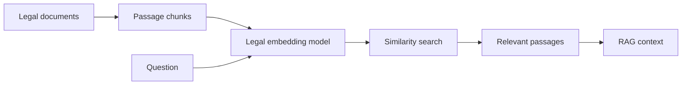

# Domain Adaptive Retrieval

**Find relevant passages in legal documents.**

A compact English embedding model fine-tuned on LegalBench-RAG to retrieve source passages for retrieval-augmented generation (RAG). The repository covers the complete workflow from document preparation to a packaged checkpoint.



## What you can do

- **Prepare documents:** clean text, create passage chunks and split data by source document.
- **Fine-tune:** mine hard negatives, train the encoder and select a checkpoint using validation data.
- **Search:** encode questions and passages, then rank passages by vector similarity.
- **Evaluate:** save ranked predictions, retrieval metrics and paired bootstrap intervals.
- **Package:** prepare Hugging Face model cards, inference files and evidence checksums.

<!-- BEGIN MODEL LINKS -->
## Model

[Hugging Face model card](docs/model-cards/legal-embedding.md) · [Evaluation details](docs/results/legal.md)
<!-- END MODEL LINKS -->

| Property | Details |
|---|---|
| Input | English legal questions and passages |
| Embeddings | 384 dimensions, normalized for similarity search |
| Evaluated passage limit | 256 tokens |
| Dataset | LegalBench-RAG, with source-document splits |

## Quick start

Use Python 3.11+ and [uv](https://docs.astral.sh/uv/). Install dependencies:

```bash
uv sync --extra train --extra benchmark --extra report
```

The example uses a trained checkpoint at `outputs/legal/embedding/model`. Weights are excluded from Git; [train a checkpoint](#train-and-evaluate) if needed. Run this with `uv run --no-sync python`:

```python
from sentence_transformers import SentenceTransformer

model = SentenceTransformer("outputs/legal/embedding/model", device="cpu")
model.max_seq_length = 256
prefix = "Represent this sentence for searching relevant passages: "
question = "When can either party terminate the agreement?"
passages = [
    "Either party may terminate with thirty days' written notice.",
    "Payment is due within fifteen days of the invoice.",
]
query = model.encode([prefix + question], normalize_embeddings=True)
documents = model.encode(passages, normalize_embeddings=True)
print(passages[int((query @ documents.T).argmax())])
```

## Train and evaluate

Training downloads the dataset and requires a CUDA GPU. Save a new run separately:

```bash
uv run --no-sync dar train embedder --domain legal --profile t4 \
  --output outputs/reproduction
uv run --no-sync dar evaluate embedder --domain legal --profile t4 \
  --checkpoint outputs/reproduction/legal/embedding/model \
  --output outputs/reproduction/legal/embedding/evaluation
```

Use the new checkpoint path in the quickstart. Adjust the [legal configuration](configs/domains/legal.yaml) and [runtime profile](configs/experiments/t4.yaml) for your hardware.

Evaluation searches within each source document. Retrieved passages can supply context to an LLM; answer generation and answer quality need separate evaluation.

## Hugging Face assets

Build the featured report and prepare local release packages:

```bash
uv run --no-sync dar report suite --input outputs \
  --featured-model legal/embedding --readme README.md \
  --package-output dist/huggingface
```

Packages include weights, model cards, inference examples and evaluation evidence. Assets are prepared locally; uploading is a separate `dar publish model` step.

## Project layout

| Path | Contents |
|---|---|
| [`src/domain_adaptive_retrieval/`](src/domain_adaptive_retrieval/) | Data, training, retrieval, evaluation and release tooling |
| [`configs/`](configs/) | Dataset, training and runtime settings |
| [`notebooks/`](notebooks/) | Colab workflows |
| [`tests/`](tests/) | Automated checks |
| [`docs/workflows.md`](docs/workflows.md) | Usage and reproduction guide |

[Contributing](CONTRIBUTING.md) · [MIT license](LICENSE). Model weights and datasets retain their own license terms.
