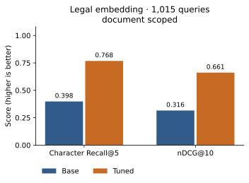

# Legal results

[Evaluation overview](README.md) · [Full-precision data](results.json) · [CSV](metrics.csv)

Document-scoped retrieval; custom split grouped by source document.

## Embedding

Tuned Character Recall@5 **0.7680** vs **0.3984** base (Δ +0.3696).

1,015 test queries; 63,807 documents across the loaded dataset. Protocol: `document_scoped`. [Model card](../model-cards/legal-embedding.md).

| Metric | Base | Tuned | Δ | 95% CI of Δ |
|---|---:|---:|---:|---|
| Character Recall@5 | 0.3984 | 0.7680 | +0.3696 | [+0.3412, +0.3979] |
| nDCG@10 | 0.3159 | 0.6611 | +0.3452 | [+0.3249, +0.3643] |
| hit@10 | 0.6611 | 0.9389 | +0.2778 | — |
| hit@5 | 0.4867 | 0.8601 | +0.3734 | — |
| Character Precision@5 | 0.0312 | 0.0697 | +0.0385 | — |
| Source-balanced Character Recall@5 | 0.4884 | 0.7460 | +0.2576 | — |
| map@10 | 0.2234 | 0.5595 | +0.3362 | — |
| MRR@10 | 0.2887 | 0.7142 | +0.4255 | [+0.4009, +0.4520] |
| nDCG@5 | 0.2511 | 0.6087 | +0.3576 | — |
| Recall@10 | 0.5040 | 0.7877 | +0.2837 | — |
| Recall@100 | 0.9162 | 0.9849 | +0.0687 | [+0.0566, +0.0807] |
| Recall@50 | 0.8489 | 0.9635 | +0.1146 | — |

### Character recall by source

| Source | Queries | Base Character Recall@5 | Tuned |
|---|---:|---:|---:|
| contractnli | 137 | 0.9468 | 0.9658 |
| cuad | 568 | 0.3501 | 0.7512 |
| maud | 254 | 0.1972 | 0.7556 |
| privacy_qa | 56 | 0.4596 | 0.5114 |

Scores use known judgments; higher is better. Δ = tuned − base. Intervals are saved query-level paired bootstraps (1,000 resamples); a dash means no interval was recorded. Full settings, runtime measurements and source SHA-256 digests are in the JSON export.
